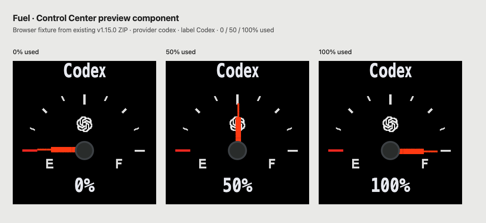
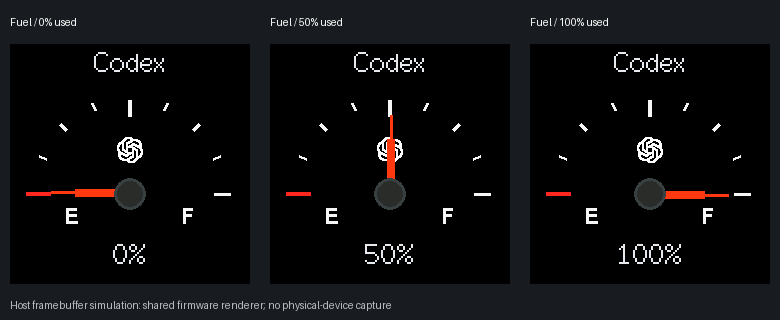

# Fuel needle example and review evidence

This is the existing Fuel **1.15.0** pack (ThemeSpec revision **16**), retained byte for byte for PR #963. It is a review example, not a catalog addition.

- [Download the theme ZIP](vibetv-theme-fuel-v1.15.0.zip)
- [Manifest](pack/manifest.json), [ThemeSpec](pack/theme.json), and [original CBI assets](pack/assets/)
- ZIP SHA-256: `0c7de4fc5c0cb8637c9446a1c8a4396aeb6be02b85ab4e817bb56dd0511847da`
- Requires `usage-slots-v1`, `text-valign-v1`, `provider-assets-v1`, and `progress-needle-v1`. The manifest's older `minFirmware` value alone does not establish needle compatibility.

## Control Center preview



Chrome capture of the actual `ThemeSpecPreview` React component, rendered from this pack's spec and CBI assets with `animate=false`. This is a browser fixture of the production preview component, not a capture of a paired, running desktop application. The provider is `codex`, label `Codex`, usage mode `used`, slot 1 available at 0/50/100%. The preview's font differs from the physical firmware font; the image preserves the current component output.

## Native firmware framebuffer simulation



Individual 240×240 frames: [0%](evidence/fuel-native-0.png), [50%](evidence/fuel-native-50.png), [100%](evidence/fuel-native-100.png).

The [evidence-only native harness](capture-native.cpp) calls the real `CompileThemeSpec`, `RenderCompiledThemeSpec`, and `NeedleSourcePixel` from `firmware_shared/theme_spec_renderer_core.h`. It reads the original CBI files and uses TFT_eSPI Font 2 bitmap data. All seven Fuel primitives execute in order; the needle angles are 270°, 0°, and 90°. Command-count and pixel checks verify the red blade points left/up/right respectively.

**This is a host framebuffer simulation, not a physical-device photograph or a capture from the official `virtual-vibetv` executable.** That executable currently simulates the device protocol and returns frame JSON, not rendered pixels. The harness supplies a limited raster sink for Fuel's sprites, text, and rounded rectangles; it mirrors the ESP8266 sink for these operations. The shared compiler and needle sampler execute directly. It verifies static full frames, not LCD color/orientation, SPI transfer, installation, ESP8266 memory/timing, partial redraws, or ghosting. If a physical device or the official virtual-device environment is specifically required, that evidence remains outstanding.

The captures use the renderer and preview source at `b27a8deed9cb5f12f36af2b0542003a705612a25`. The shared renderer SHA-256 is `26dfaf0c77a8b91f570eb7cdf4da7faf280da862c99a6a158563650fe8728850`. The follow-up only removes unrelated 3D material changes and adds this evidence.

## Reproduce

Validate without installing or writing to a device, from `companion/`:

```sh
go run ./cmd/codexbar-display theme-pack validate --pack ../docs/examples/fuel/vibetv-theme-fuel-v1.15.0.zip
```

For the native capture, install the repository's PlatformIO dependencies for `native_theme_spec_renderer` and `esp8266_smalltv_st7789`, a C++17 compiler, and Python with Pillow. Then run from the repository root:

```sh
sh docs/examples/fuel/capture-native.sh
```

It writes only to this example's ignored `out/` directory and `render` executable. PNG conversion expands RGB565 to RGB888; the contact sheet only arranges the original rendered frames and adds labels.

For the browser capture, install the Control Center dependencies and Chrome, then run from the repository root:

```sh
npm exec --prefix apps/control-center -- vitest run --config docs/examples/fuel/capture-preview.config.mts --configLoader native
npm exec --prefix apps/control-center -- playwright screenshot --channel chrome --viewport-size '1220,560' --wait-for-timeout 800 "file://$PWD/docs/examples/fuel/out/control-center.html" docs/examples/fuel/out/fuel-control-center.png
```

The [fixture](capture-preview.test.ts) loads the extracted pack, checks the three needle angles and text, and writes the HTML for the browser. The [configuration](capture-preview.config.mts) resolves the existing app dependencies. No Companion connection, credentials, or device write is involved.

The unrelated 3D housing/rim observation is tracked separately in [issue #972](https://github.com/DreamyTalesPAN/CodexBar-Display/issues/972). Both 3D component files in PR #963 are restored to their base versions.
