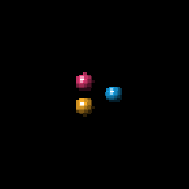

# Orbit Pebbles — proposed screensaver for #261

This is a new design proposal, not the blue ring removed on 2026-10-08.
The name and appearance still need Paul's acceptance. The preview decodes the
actual CBA frames at their 80×80 draw size on a 240×240 black canvas; it is not
a photograph, native-app screenshot, or evidence of hardware performance.

All pixels are original procedural sphere geometry and lighting from
`scripts/build-orbit-pebbles-theme.mjs`, with no source images or Microsoft
assets. Run that script and then `node scripts/build-theme-packs.mjs` to build.
One 32×32 CBA, 32 frames at 8 fps, repeats every four seconds. Its single
80×80 repaint region uses the existing renderer; no standby logic changes.
Every pixel returns to black during the loop. There are no static labels.

Before release: approve the design/name, verify the native catalog/install
flow on Mac and Windows, and measure standby entry, wake and stable rendering
on the physical device. Automated asset tests do not establish those results.
